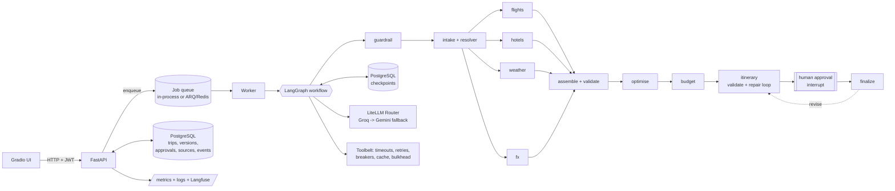

# TripMate - a multi-agent travel planner built like production software

A LangGraph workflow plans a trip end to end: it checks the request for safety, extracts trip details,
fetches flights, hotels, weather and exchange rates **in parallel**, validates every number, ranks
alternative itineraries with a multi-objective optimiser, drafts a day-by-day plan, validates and repairs
it, then **pauses for the traveller's approval** (state persisted in PostgreSQL) before finishing.

It runs entirely on **free tiers** (Groq + Gemini through a LiteLLM gateway, Open-Meteo, open.er-api.com).



## What is interesting here

| Area | What was built | Where |
|---|---|---|
| Structured outputs | Pydantic v2 models for trip, search results, budget, itinerary; `Decimal` money with ISO-4217 exponents | `schemas/`, `domain/` |
| Data correctness | Date, currency, price-plausibility, time-zone, flight-duration and source-freshness validators | `validation/` |
| Honest data | Flight prices are *estimates* (no free real-time API exists) and labelled as such; hotel prices are only shown if found in a cited search result, otherwise typical regional rates are used and flagged | `providers/flights.py`, `agents/nodes.py` |
| Reliability | Timeouts, bounded retries with exponential backoff + jitter, circuit breakers, bulkheads, load shedding, single-flight cache, graceful degradation | `resilience/`, `providers/toolbelt.py` |
| Persistent workflow | PostgreSQL LangGraph checkpoints; a plan paused for approval survives restarts; resume is idempotent | `graph/`, `tests/integration/` |
| Security | scrypt + JWT (alg pinned), lockout, rate limits, strict input models, body-size cap, security headers, secret redaction, approvals bound to an itinerary version + `Idempotency-Key`, ownership checks that return 404 | `security/`, `api/`, `observability/redaction.py` |
| Planning | Pareto front over cost / travel time / quality, weighted utility, three alternatives, learned preferences | `optimizer/` |
| Evaluation | 16 golden cases, deterministic scorers (no LLM judge), regression gate against a committed baseline | `evals/`, `evals/datasets/` |
| Observability | Structured JSON logs with request/plan ids, Prometheus metrics + alert rules, Langfuse tracing via LiteLLM | `observability/`, `deploy/prometheus/` |
| Scale | Queue-based jobs (in-process or ARQ/Redis), stateless API, DB-backed SSE (works across replicas), Redis cache/limiter | `jobs/`, `docker-compose.yml` |
| CI/CD | Lint, mypy, tests on real Postgres + Redis, eval gate, bandit, pip-audit, gitleaks, trivy, image smoke test, CodeQL, deploy | `.github/workflows/` |

## Quick start

```bash
cp .env.example .env            # add GROQ_API_KEY and/or GEMINI_API_KEY (free)
docker compose up --build       # Postgres + Redis + API + 2 workers
# UI:  http://localhost:8000/ui      API docs: http://localhost:8000/docs
```

Without Docker (SQLite + in-memory checkpoints, single process):

```bash
python -m venv .venv && source .venv/bin/activate
pip install -e ".[dev,scale,observability]"
tripmate-api
```

```bash
make test      # unit, workflow, service, API, contract, failure-path tests with coverage
make eval      # golden-case evaluation + regression gate (offline, deterministic, no keys)
make lint typecheck security
```

## Testing strategy

* **Unit** - money, schemas, validators, optimiser, resilience primitives, redaction, security, UI rendering.
* **Failure-path** - provider timeouts, 429s, bad JSON, open circuits, model returning garbage, queue overflow.
* **Workflow** - the real node functions driven end to end with scripted LLM/providers (guardrail, clarification, degradation, repair loop, approval/revision, edits).
* **Service** - ownership, idempotent approvals, stale-version rejection, retries, stale-run recovery, duplicate job delivery.
* **API** - auth/lockout, problem+json, rate limits, body limits, headers, metrics (`httpx` ASGI transport).
* **Contract** - the in-memory and SQL repositories must satisfy identical behaviour tests.
* **Integration** - Postgres checkpoint resume across a simulated restart (CI service container).
* **Evaluation** - golden cases and quality scoring (see `docs/ARCHITECTURE.md`).

## Free-tier model choices

Models are configuration, not code (`TRIPMATE_LLM_SMART_MODELS`, `TRIPMATE_LLM_FAST_MODELS`). Defaults:
Groq `gpt-oss-120b` / `gpt-oss-20b` with Gemini `3.8-flash` / `3.5-flash-lite` as automatic fallbacks. Note: Groq
retired `llama-3.3-70b-versatile` and `llama-3.1-8b-instant` for free/developer tiers on 2026-08-16, so the
previous version of this project could no longer run as-is.

## Docs

[Architecture](docs/ARCHITECTURE.md) - [Decision records](docs/adr) - [Runbook](docs/RUNBOOK.md) -
[Security](SECURITY.md) - [Interview guide](docs/INTERVIEW_GUIDE.md)
